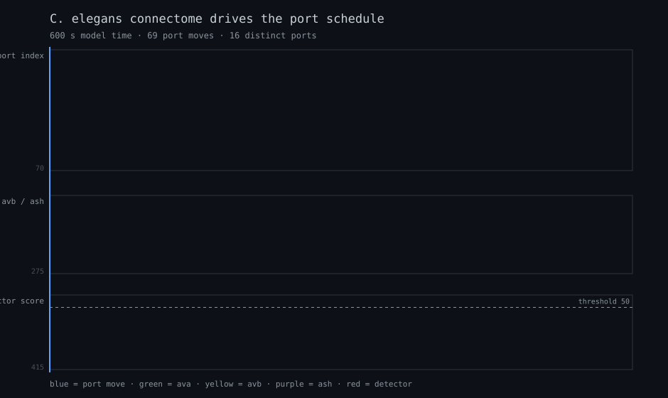
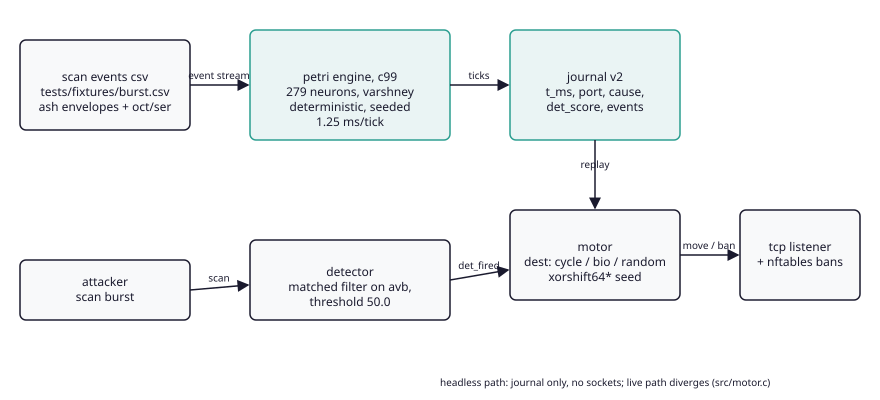
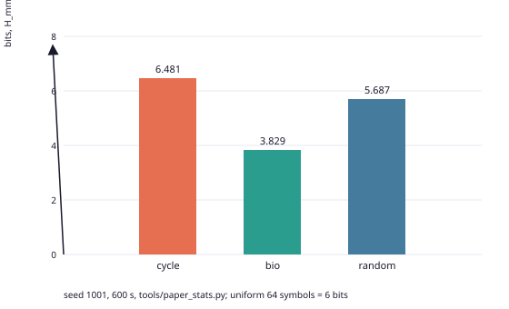
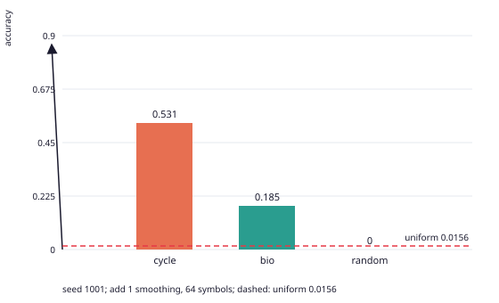
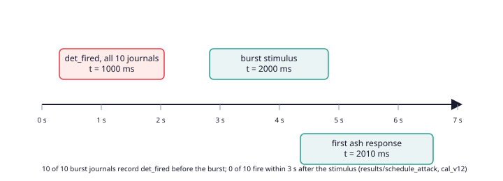

# proteus

[](https://github.com/esnond/proteus/actions/workflows/ci.yml)

**a headless tcp port schedule labelled by a reduced readout of a simulated
*C. elegans* connectome. a scientific report and a catalogue of refutations.
the connectome does not close the loop.**

русская версия: [README.md](README.md)



## abstract

proteus is a deterministic headless tcp port schedule. the tick is set by
the body speed reflex and the detector; the label in bio mode is a hand
written readout of six scalars from a reduced connectome model (279
neurons, graded potentials, serotonin, octopamine and dopamine
modulation). the petri engine was written from scratch and is vendored
under `src/petri/`. the entire measured path is headless: it opens no
sockets, the live path diverges from the journal, and this is stated
explicitly. four of the six readout terms are not independent neural
observables. the full study with methods, statistics and the list of
retracted claims is [paper/FINAL.md](paper/FINAL.md).

the scientific result is negative, and that is the point: every defensive
property is refuted by measurement, and every number traces to a command.

## key measurements

| quantity | value | n | note |
|---|---|---|---|
| quiet move rate | mean 97.5 per 600 s, t-CI [79.7, 115.3] | 10 seeds | registered band [100, 300] missed, recorded |
| detector false alarms | 8 over 6000 s | 10 x 600 s | no interval: events are not independent |
| burst detection | 8/10 retracted; 3/10 is t0 = 1000 ms before the stimulus | 10 journals | firmware det_fired 0/10 after 2010 ms; raw 2/10 |
| detector threshold | 50.0 | frozen | shipped grid: 45:12, 50:8 |
| passive learnability L | cycle 88/100 at L=65, bio 0/100, random 0/100 | 100 parties | party lengths 44 to 155, sentinel 500 for 212/300 |
| marginal entropy H, n=20 | bio 4.014 [3.885, 4.136] vs random 5.468 [5.402, 5.539] | 20 journals | confounded by alphabet, diagnostic |
| held out accuracy, n=20 | bio 0.0712 [0.0540, 0.0901] vs random 0.0100 [0.0047, 0.0158] | 20 journals | uniform 0.0156; exploratory, smoothing confound |
| order 1 log-loss, n=20 | bio 5.851 vs random 6.025, paired [-0.221, -0.129] | 20 journals | effect 0.174 bits; order 0 5.058 vs 6.364 |
| seed recovery | 3 observed ports, under one second, 200001 candidates | 1 seed, source knowledge | four structural tests 0/20; no blind seed-recovery attack |
| no-op moves | 15.1% of 10048 | 100 journals | move without a port change |

every number is regenerated by `tools/paper_stats.py`, output in
`results/paper_stats.txt`. the bulk journals (1.3 GB) live in a zenodo
archive, see [results/BULK_DATA.md](results/BULK_DATA.md).

## figures

| figure | what it shows |
|---|---|
|  | data flow: events, engine, journal, motor, network |
|  | H_mm of port labels per mode, diagnostic only |
|  | held out accuracy against the uniform level 0.0156 |
|  | the detector fires before the stimulus, basis of the 8/10 retraction |
|  | move rate CI against the registered band |

## refutations the project stands behind

- biology is not more random than a PRNG: at 64 symbols the ceiling is
  6 bits per move, and L saturates for any near uniform source;
- the random arm is broken at the seed policy level: xorshift64* is
  recoverable from 3 ports in under one second over 200001 candidates with
  source knowledge, `tools/seed_recovery_attack.py`;
- the bio readout is rank one: a mean of six scalars yields 16 distinct
  ports of 64; the readout is a sufficient bottleneck, the connectome
  contribution is untested;
- the detector does not establish the burst: 8/10 is retracted, 3/10 is
  t0 = 1000 ms before the stimulus, firmware det_fired is 0/10 after 2010 ms;
- timing is mode independent: the move instant is set by the body speed
  reflex and the avb filter, the mode chooses only the label.

the four still winnable claims and their experiments:
[docs/PLAN_V11.md](docs/PLAN_V11.md).

## build and run

```bash
make                       # cc -std=c99 -pedantic -Wall -Wextra -Werror -O2
make test                  # unit + replay determinism

# headless party, journal to a file
./proteusd -s 1 -d 60 -e tests/fixtures/burst.csv -o /tmp/party.csv

# destination mode: cycle (counter) | bio (connectome) | random
./proteusd -s 1 -d 60 -e tests/fixtures/burst.csv --dest-mode bio

# live listener with the ipc control socket
./proteusd -s 1 -d 600 --listen --socket /tmp/p.sock -o /tmp/party.csv
./proteusctl status --socket /tmp/p.sock
```

## architecture

| component | role |
|---|---|
| `src/petri/` | vendored connectome engine v1.2: 279 neurons, graded potentials, stsp, modulators, body physics |
| bridge | engine ownership, membrane noise, modulator injection, state readout |
| detector | matched filter on avb, 1 s window, frozen threshold |
| reflex | engine native reversal: speed below 0.02 mm/s sustained 500 ms |
| motor | port window 40000..40063, non blocking listener |
| sensor | non blocking accept, payload classification, ban list |
| nft | netlink (libmnl) built by hand, table `proteus`, set `banned` |
| seccomp | 31 syscall bpf filter from a static binary strace |
| ipc | SOCK_SEQPACKET, SO_PEERCRED, group auth |
| journal | versioned 11 column csv, one row per 10 ms of model time |

## reproducibility

every run records binary sha256, commit, compiler, flags, seed range and
the event file hash. party replay is bitwise:

```bash
./proteusd -s 42 -d 600 -e tests/fixtures/burst.csv -o a.csv
./proteusd -s 42 -d 600 -e tests/fixtures/burst.csv -o b.csv
cmp a.csv b.csv && echo "bitwise identical"
```

release manifest: `results/manifest.txt` (commit, compiler, flags, sha256
of every artifact). honest boundary: replay is verified on one compiler
and libm pairing; cross platform bitwise identity is not claimed until
libm is replaced by a vendored layer.

## ai use disclosure

per the icmje and elsevier practice: large language model tools were used
as assistance for documentation editing, auxiliary script generation and
visualization. the scientific design, the petri engine code, all
measurements, interpretations and decisions are the author's. ai is not
an author; a human is accountable for the content. details:
[paper/AI_ASSISTANCE.md](paper/AI_ASSISTANCE.md).

## status and citation

closed at v1.0.3 (2026-10-30), the repository is frozen. closing report:
[docs/CLOSE.md](docs/CLOSE.md). license ISC, see `LICENSE`. cite the
repository (zenodo doi in preparation, metadata in `CITATION.cff` and
`.zenodo.json`) and the engine's primary sources: Yemini et al. 2013,
pierce-shimomura et al. 1999, Kato et al. 2015, Tsodyks and Markram 1997,
wiring: Varshney et al. 2011.
